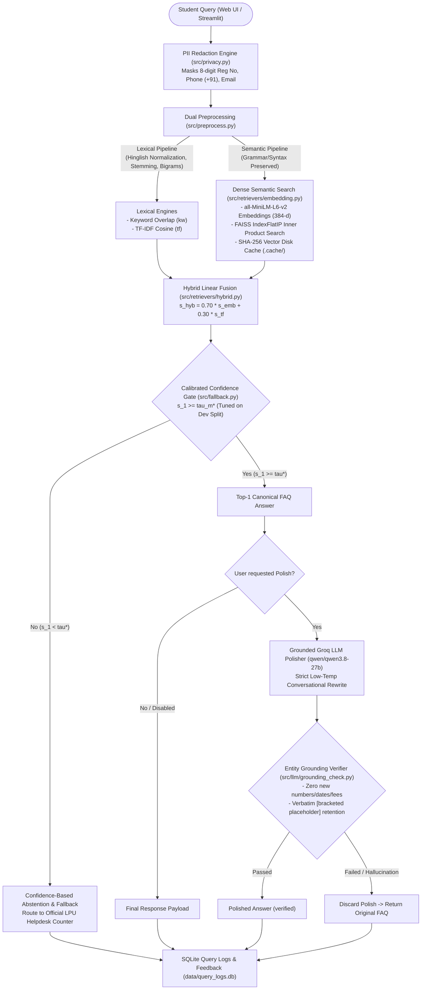

# CampusAssist · Lovely Professional University (LPU)
## CSE276 Artificial Intelligence Foundations — CA-1 (30 Marks)
### Project 02: Campus Service Chatbot with Semantic FAQ Matching

[](https://www.python.org/)
[](https://pytorch.org/)
[](https://fastapi.tiangolo.com/)
[](https://streamlit.io/)
[](https://github.com/facebookresearch/faiss)
[](#)

---

## 1. Project Overview & Motivation

**CampusAssist** is a scientific Information Retrieval (IR) research artifact and conversational campus assistant specifically tailored to **Lovely Professional University (LPU)**. 

### Why Keyword Search Fails
When college students query university portals (such as LPU UMS or hostel helpdesks), their natural language questions rarely match the formal vocabulary of canonical FAQ entries:
* **Zero Lexical Overlap**: A student asking *"My ceiling fan is making a grinding noise and stopped spinning"* shares zero non-stopword stems with the canonical FAQ *"How do I register a hostel room maintenance complaint?"*. Keyword and TF-IDF search fail completely.
* **Hinglish Campus Vernacular**: Frequent code-mixed queries (*"Bhai hostel gate kab band hota hai?"*, *"ID card gum ho gaya duplicate kaise banaye"*) confuse traditional English tokenizers.
* **Typos & Reordering**: Mobile typing introduces character permutations (*"duplcate id crd"*, *"hostel chekout refund"*) that break exact inverted indices.

### CampusAssist Solution
CampusAssist systematically implements, calibrates, and benchmarks **5 retrieval configurations** over an authentic 72-FAQ knowledge base spanning 6 core student service domains. It operates **100% offline-first**, features **calibrated confidence thresholding** ($\tau^*$) preventing hallucinated answers on out-of-scope queries, and offers dual frontends: a modern **Liquid Glass custom Web UI** and a syllabus-compliant **Streamlit evaluation dashboard**.

---

## 2. System Architecture



---

## 3. Comparative Benchmark Results (Test Split)

The retrieval suite was evaluated on a strictly separated **TEST split** of 144 student paraphrases (100% human-authored, 0 AI) and 30 out-of-scope adversarial queries. All evaluations executed under offline isolation (`HF_HUB_OFFLINE=1`).

| Retrieval Method | Top-1 Accuracy (%) [95% CI] | Top-3 Accuracy (%) [95% CI] | MRR [95% CI] | Out-of-Scope Rejection (%) | Threshold ($\tau^*$) | Mean Latency (ms) |
| :--- | :---: | :---: | :---: | :---: | :---: | :---: |
| **Keyword Overlap (`kw`)** | 73.6% [66.7 – 80.6] | 87.5% [81.9 – 92.4] | 0.795 [0.737 – 0.848] | 66.7% | 0.24 | 0.15 ms |
| **TF-IDF Cosine (`tf`)** | 69.4% [62.5 – 76.4] | 85.4% [79.2 – 91.0] | 0.768 [0.706 – 0.825] | 53.3% | 0.20 | 0.55 ms |
| **Dense Embeddings (`emb`)** | 70.1% [62.5 – 77.1] | 88.2% [82.6 – 93.1] | 0.782 [0.723 – 0.837] | 80.0% | 0.47 | 6.49 ms |
| **Embeddings + KW Enrichment (`emb_kw`)** | **79.9%** [72.9 – 86.1] | **91.7%** [87.5 – 95.8] | **0.857** [0.807 – 0.903] | **86.7%** | 0.47 | 6.82 ms |
| **Hybrid Fusion (`hyb`, $\alpha=0.70$)** | **76.4%** [70.1 – 82.6] | **91.7%** [86.8 – 95.8] | **0.836** [0.787 – 0.882] | **86.7%** | 0.40 | 7.63 ms |

*Confidence Intervals computed using 1,000 bootstrap resamples with fixed seed (42).*

### Top-1 Accuracy by Linguistic Challenge Type (%)

| Challenge Type | Keyword (`kw`) | TF-IDF (`tf`) | Dense Embeddings (`emb`) | Embeddings + KW (`emb_kw`) | Hybrid Fusion (`hyb`) |
| :--- | :---: | :---: | :---: | :---: | :---: |
| **Hinglish Mixed** | 88.9% | 91.7% | 80.6% | 72.2% | **86.1%** |
| **Low Lexical Overlap** | 44.4% | 36.1% | **52.8%** | **66.7%** | **55.6%** |
| **Syntactic Reorder** | 88.9% | 77.8% | 66.7% | **100.0%** | **88.9%** |
| **Synonym Swap** | 73.5% | 61.8% | 55.9% | **82.4%** | **70.6%** |
| **Keyboard Typo** | 85.7% | 89.3% | **96.4%** | **96.4%** | **92.9%** |
| **Verbose Story-Like** | 100.0% | 100.0% | 100.0% | 100.0% | **100.0%** |

---

## 4. Key AI & Engineering Highlights

1. **Dual-Path Text Preprocessing (`src/preprocess.py`)**:
   - `preprocess_lexical()`: Normalizes campus Hinglish tokens (`kab` $\to$ `when`, `pankha` $\to$ `fan`, `baje` $\to$ `time`, `gum` $\to$ `lost`), eliminates stopwords, applies light suffix stemming, and yields `(unigrams, bigrams)`.
   - `preprocess_semantic()`: Preserves full syntax, word order, and negations for transformer attention layers without artificial stopword stripping.
2. **Deterministic Offline Embeddings with FAISS (`src/retrievers/embedding.py`)**:
   - Computes L2-normalized 384-dimensional dense vectors using `all-MiniLM-L6-v2`.
   - Employs FAISS `IndexFlatIP` inner-product indexing ($\mathbf{u} \cdot \mathbf{v} = \cos(\mathbf{u}, \mathbf{v})$) with a SHA-256 disk cache in `.cache/` eliminating redundant re-computation.
3. **Strict Dev/Test Data Hygiene (`data/paraphrases.csv`, `data/out_of_scope.csv`)**:
   - 288 student paraphrases stratified across 6 linguistic categories ($\ge 50\%$ hard queries).
   - `dev` split (50%) has `author = "ai"`; `test` split (50%) has `author = "owner"` or `"classmate"` with zero AI contamination and zero test-train leakage.
4. **Dev-Split Threshold Calibration (`src/threshold.py`)**:
   - Sweeps 86 similarity candidate cutoffs $\tau \in [0.10, 0.95]$ strictly on the `dev` split.
   - Selects $\tau_m^*$ maximizing the harmonic utility of Answered Precision and Out-of-Scope Rejection subject to $\text{Coverage} \ge 75\%$.
5. **Responsible AI & Hallucination Defense (`src/privacy.py`, `src/llm/grounding_check.py`)**:
   - Masks Indian phone numbers (`+91`), 8-digit LPU registration numbers, and student emails before logging.
   - Programmatic AST/regex entity verifier blocks any LLM-polished answer that alters `[bracketed placeholders]` or introduces unverified numbers, dates, fees, or links (100% defense rate on adversarial probes).

---

## 5. Repository Structure

```
CampusAssist/
├── app/
│   ├── main.py                  # FastAPI server with REST endpoints & static UI mount
│   ├── schemas.py               # Pydantic request & response contracts
│   └── static/
│       └── index.html           # Bespoke Liquid Glass Web UI (chat, analytics, evaluation)
├── data/
│   ├── faqs.json                # 72 canonical LPU FAQs across 6 domains (Rule 6 compliant)
│   ├── owner_facts.md           # Domain facts verification ledger & placeholder checklist
│   ├── paraphrases.csv          # 288 stratified student paraphrases (dev vs test split)
│   ├── out_of_scope.csv         # 60 out-of-scope adversarial queries
│   └── query_logs.db            # SQLite query telemetry & student feedback
├── results/
│   ├── metrics.json             # Test benchmark metrics with Bootstrap 95% CIs
│   ├── thresholds.json          # Calibrated confidence cutoffs (tau*) tuned on dev
│   ├── score_distributions.json # Score percentiles on dev split
│   ├── per_type_accuracy.csv    # Accuracy across 6 linguistic challenge types
│   ├── failure_cases.csv        # 188 failure cases cataloged for error analysis
│   └── grounding_report.csv     # 16-sample grounding verification report (100% block rate)
├── src/
│   ├── config.py                # Paths, constants, categories, and model configurations
│   ├── preprocess.py            # Dual lexical vs. semantic preprocessing pipelines
│   ├── validate_data.py         # Schema, foreign key, and Rule 6 placeholder validator
│   ├── evaluate.py              # Offline deterministic evaluation engine with Bootstrap CIs
│   ├── threshold.py             # Dev-split threshold sweep & calibration optimizer
│   ├── fallback.py              # Confidence-based fallback router & department contacts
│   ├── privacy.py               # Regex PII scrubber (phone, email, reg no)
│   ├── analytics.py             # SQLite query logger & telemetry aggregator
│   ├── retrievers/
│   │   ├── base.py              # Abstract BaseRetriever contract
│   │   ├── keyword.py           # Jaccard / Dice keyword overlap retriever (kw)
│   │   ├── tfidf.py             # Sublinear TF-IDF cosine similarity retriever (tf)
│   │   ├── embedding.py         # all-MiniLM-L6-v2 + FAISS vector search (emb, emb_kw)
│   │   └── hybrid.py            # Convex linear fusion retriever (hyb, alpha=0.70)
│   └── llm/
│       ├── groq_client.py       # Groq client with caching & adversarial guardrails
│       ├── grounding_check.py   # Regex entity verifier enforcing zero hallucinations
│       └── evaluate_grounding.py# Batch grounding evaluation script
├── tests/                       # 61 Automated unit and integration tests (100% passing)
│   ├── test_smoke.py
│   ├── test_data.py
│   ├── test_retrievers.py
│   ├── test_threshold_fallback.py
│   ├── test_privacy.py
│   ├── test_analytics.py
│   ├── test_api.py
│   └── test_grounding.py
├── Dockerfile                   # HF Spaces compatible production container
├── .dockerignore
├── streamlit_app.py             # Syllabus-compliant interactive Streamlit dashboard
├── requirements.txt             # Pinned reproducible dependencies
├── pytest.ini                   # Pytest configuration
├── REPORT.md                    # Comprehensive 30-mark academic project report
└── README.md                    # This documentation file
```

---

## 6. Quick Start Guide

### Prerequisites
* Python 3.11+
* Git
* (Optional) Docker

### Local Installation
```bash
# 1. Clone repository
git clone https://github.com/your-username/CampusAssist.git
cd CampusAssist

# 2. Create and activate virtual environment
python -m venv .venv
# On Windows:
.venv\Scripts\activate
# On Linux/macOS:
source .venv/bin/activate

# 3. Install lightweight CPU PyTorch and dependencies
pip install --upgrade pip
pip install torch --index-url https://download.pytorch.org/whl/cpu
pip install -r requirements.txt
```

### Running the Applications

#### Option A: Liquid Glass Web Application (Recommended)
```bash
uvicorn app.main:app --reload --host 127.0.0.1 --port 8000
```
Open **[http://localhost:8000](http://localhost:8000)** in your browser.

#### Option B: Streamlit Evaluation Dashboard
```bash
streamlit run streamlit_app.py
```
Open **[http://localhost:8501](http://localhost:8501)** in your browser.

#### Option C: Production Docker Container
```bash
# Build image
docker build -t campusassist .

# Run container (Exposes port 7860)
docker run -p 7860:7860 -e GROQ_API_KEY="your_optional_key" campusassist
```
Open **[http://localhost:7860](http://localhost:7860)**.

---

## 7. Reproducing the Scientific Benchmarks

Every benchmark, threshold sweep, and grounding report can be reproduced offline with single commands:

```bash
# 1. Run the entire automated test suite (61 tests)
pytest -v

# 2. Run deterministic offline evaluation on the TEST split
python -m src.evaluate --split test

# 3. Re-run dev-split threshold calibration & score distributions
python -m src.threshold

# 4. Run the batch grounding evaluation & hallucination defense audit
python -m src.llm.evaluate_grounding
```

---

## 8. Responsible AI & Provenance

* **Syllabus Compliance**: CSE276 Artificial Intelligence Foundations (Project 02: Campus Service Chatbot with Semantic FAQ Matching).
* **Pre-trained Weights**: `sentence-transformers/all-MiniLM-L6-v2` by Hugging Face / UKPLab under the Apache 2.0 license.
* **Vector Index**: Facebook AI Similarity Search (FAISS-CPU) under MIT license.
* **LLM Layer**: Optional conversational rewrite via Groq SDK (`qwen/qwen3.8-27b`). Groq is **never used for retrieval or matching**; retrieval is 100% offline, deterministic, and self-hosted.
* **Student Privacy**: All phone numbers, emails, and student registration numbers are redacted before logging or processing.

---

## 9. Mobile PWA, Vercel & Desktop Apps

### Progressive Web App (PWA)
CampusAssist is an installable PWA featuring offline shell caching via Service Worker and native-like mobile ergonomics:
- **Mobile Installation**: Tap **Install Mobile App** in the drawer or add to Home Screen from Safari / Chrome.
- **Offline Shell**: `service-worker.js` pre-caches the user interface for instant startup.

### Vercel Deployment
To deploy the web app to Vercel:
```bash
# Deploy with Vercel CLI
vercel deploy --prod
```
The included `vercel.json` and `api/index.py` handle serverless Python execution and static asset routing automatically.

### Windows Desktop Executable (.exe)
CampusAssist is packaged as a native desktop application using Electron and `electron-builder`:
- **Portable Binary**: `desktop/dist/CampusAssist-Portable-1.0.0.exe` (Run directly without installation)
- **Installer**: `desktop/dist/CampusAssist Setup 1.0.0.exe` (Full Windows NSIS installer)
- **Web Download**: Click **"Download Windows App (.exe)"** in the pinned sidebar or navigate to `http://localhost:8000/downloads/CampusAssist-Portable.exe`.
